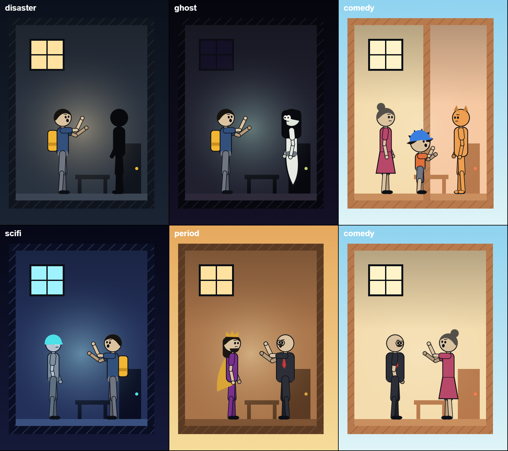

# cutaway-cartoon

สกิลสำหรับ Claude Code ที่ทำการ์ตูนแนวตั้งพากย์ไทยแบบ "บ้านตัดขวาง" วาดด้วยโค้ดทั้งหมดบน canvas ฉากเดียว กล้องเลื่อนต่อเนื่องไม่ตัดภาพ ตัวละครข้อต่อ คำบรรยายตัวใหญ่ การ์ดกฎ และจุดค้างท้ายตอน ใช้ได้ทุกแนว ทั้งภัยพิบัติ ผี ตลก ไซไฟ และย้อนยุค



สกิลครบในตัว ไม่ต้องติดตั้งสกิลอื่น มีโค้ดวาด ชุดเครื่องมือสร้างคลิป เสียงพากย์ด้วย Gemini TTS การตรวจเฟรม และเรื่องตัวอย่างที่ลองสร้างได้ทันที

## ติดตั้ง

พิมพ์ใน Claude Code:

```
ช่วยติดตั้งสกิล cutaway-cartoon จาก teerawattpl-wq/cutaway-cartoon (คัดลอกโฟลเดอร์ cutaway-cartoon ไปไว้ใน ~/.claude/skills)
```

หรือทำเอง: คัดลอกโฟลเดอร์ `cutaway-cartoon/` ในที่นี้ไปไว้ใน `~/.claude/skills/`

## ที่ต้องมี

- Python 3.10 ขึ้นไป พร้อม `numpy` `scipy` และ `pillow`
- ffmpeg
- Node.js 18 ขึ้นไป (ใช้ `npx hyperframes` ตอนเรนเดอร์)
- ไฟล์ `.env` ในโฟลเดอร์โปรเจกต์ที่ใส่ `GEMINI_API_KEY=...` สำหรับสร้างเสียงพากย์ฟรี **ห้ามใส่ไฟล์นี้ตอนแชร์หรือส่งโปรเจกต์ต่อ**

## เริ่มใช้

เปิดโฟลเดอร์ว่างใน VS Code แล้วบอก Claude ว่าอยากทำการ์ตูนอะไร เช่น

```
อยากทำการ์ตูนตัดขวางแนวตลก เรื่องป้ากับแมวส้มทะเลาะกันเรื่องรีโมต
```

Claude จะตั้งโปรเจกต์ ถามทีละข้อ ร่างบทให้ตรวจ สร้างเสียง วาด และตรวจเฟรมให้ คุณเป็นคนดูการเคลื่อนไหวและฟังเสียงเอง เพราะ Claude ตรวจได้แค่ภาพนิ่ง

## ในโฟลเดอร์นี้มีอะไร

| ที่อยู่ | คืออะไร |
|---|---|
| `cutaway-cartoon/SKILL.md` | คำสั่งที่ Claude อ่าน: ลำดับงาน ตัวละคร ฉาก กล้อง ข้อมูลบนจอ |
| `cutaway-cartoon/assets/` | โค้ดวาด: ตัวละคร ฉาก คำบรรยาย การ์ด |
| `cutaway-cartoon/kit/` | เครื่องมือสร้างคลิป: เสียง เส้นเวลา storyboard ตรวจเฟรม |
| `cutaway-cartoon/tools/setup_project.py` | ตั้งโปรเจกต์ใหม่ครั้งเดียว |
| `cutaway-cartoon/examples/hello/` | เรื่องสั้นสามบรรทัดที่ใช้ครบทุกส่วน |

ฟอนต์ที่แถมมา (Kanit และ Pridi) ใช้สัญญาอนุญาต SIL Open Font License ซึ่งอนุญาตให้แจกต่อได้

## ข้อควรรู้

- เสียงพากย์เป็นเสียงสังเคราะห์ ตอนอัปโหลดให้ติ๊กว่ามีเนื้อหาที่สร้างด้วย AI
- เรื่องแต่งต้องบอกคนดูว่าแต่ง และกฎในเรื่องต้องไม่หน้าตาเหมือนคำแนะนำความปลอดภัยจริง
- ตัวเลขหรือข้อเท็จจริงจริงต้องมีแหล่งที่ตรวจแล้ว

## ใบอนุญาต

โค้ดและเอกสารในที่นี้ใช้สัญญาอนุญาต MIT (ดูไฟล์ `LICENSE`) ส่วนฟอนต์ใน `cutaway-cartoon/kit/fonts/` ใช้ SIL Open Font License ของฟอนต์เอง
